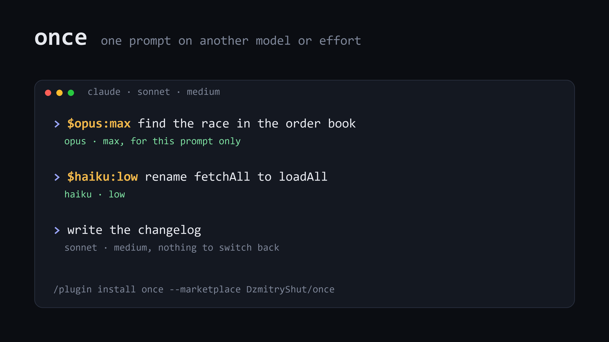

# once

A Claude Code mod that sets the effort, the model, or both for a single prompt. `$low` for routine prompts, `$max` for hard ones. Your next prompt runs on your usual settings again.



## Install

At the prompt of a Claude Code session:

```
/plugin install once --marketplace DzmitryShut/once
```

Answer `y` to add the marketplace, then pick a scope. From a shell:

```
claude plugin install once --marketplace DzmitryShut/once
```

In the desktop app, click **+** next to the prompt box, then **Plugins**, **Add marketplace** with `DzmitryShut/once`, then **Add plugin**.

## Usage

Start a prompt with `$` and an effort level:

```
$low   rename fetchAll to loadAll
$high  why does this test flake?
$max   find the race in the order book
```

Effort is the setting to switch first. It costs nothing extra: the prompt cache belongs to the model, so `$low` and `$max` keep reading your session's cache ([measured below](#what-a-switch-costs)). Use `$low` for routine prompts and `$max` or `$xhigh` where a miss is expensive. Levels: `low`, `medium`, `high`, `xhigh`, `max`.

Add a model when the prompt calls for one:

```
$haiku:low rename fetchAll to loadAll
$opus:max  find the race in the order book
$sonnet    review this diff
```

Another model starts with an empty cache and writes the whole conversation into its own, so a model switch is not free. It pays off when the session is under 100k tokens, when you send `$haiku` again within the hour, or when the prompt makes five or more model requests. The numbers are in [What a switch costs](#what-a-switch-costs) and [Using it to save](#using-it-to-save).

| Spec | Model | Effort |
| --- | --- | --- |
| `$opus` | Opus | unchanged |
| `$max` | unchanged | max |
| `$opus:max` or `$max:opus` | Opus | max |
| `$claude-sonnet-5-5:low` | that exact model id | low |

Models: `opus`, `sonnet`, `haiku`, `fable`, or any full `claude-*` id. Effort: `low`, `medium`, `high`, `xhigh`, `max`. Case does not matter.

The prefix is removed before the prompt reaches the model. Text that doesn't parse as a spec is sent as typed, so `$HOME is wrong` and `costs $5` are left alone.

When the last request carried more than 100k tokens and the prompt changes the model, a toast shows what the switch costs before the prompt goes through, for example: *Haiku will write ~150k tokens of context into its own cache, about $0.15. Opus would read them for about $0.03.* The prompt is never held back. The estimate uses list prices for a 1-hour cache and assumes the session's own cache is still warm. It stays quiet when the target model answered within the last hour, because its cache already holds the conversation.

## How it works

`once` never changes your session's model or effort. It hooks the model requests of the turn your prompt starts and swaps `model` and `effort` on each of them, including every request after a tool call. Once the turn ends, requests go out with the session settings again.

- Only the main agent is affected. Subagents started during that turn keep their own models.
- If you type a `$` prompt while Claude is still working, it applies from the next model request.
- If you interrupt a turn before it reaches the model, the override is dropped.

## What a switch costs

The prompt cache belongs to a model. Changing the model drops it, changing the effort does not. Measured with [`bench/cache.mjs`](bench/cache.mjs): a session on Opus 5.5 at effort `xhigh`, where each `$` prompt reads one file. Costs are Claude Code's own estimates at API prices; on a subscription they come out of your usage limits instead.

| Prompt | Session of 30-40k tokens | Session of 160-175k tokens |
| --- | ---: | ---: |
| no prefix, stays on Opus | $0.032 | $0.085 |
| `$haiku` | $0.004 | $0.160 |
| `$sonnet` | $0.091 | $0.631 |
| `$low` | $0.022 | $0.079 |
| `$max` | $0.061 | $0.111 |
| next prompt after `$haiku` (after a plain one) | $0.078 ($0.053) | $0.126 ($0.077) |

Full output, with tokens and time per request: [`bench/results.md`](bench/results.md).

- **Another model writes the conversation into its own cache.** Its first request in the large session wrote 146k tokens. The second request of the same prompt read them back.
- **`$haiku` is cheaper under 100k tokens.** There Haiku's cache write costs $0.20 per million tokens, the same as Opus reading its own cache, and the cheap output does the rest: eight times cheaper in the small session. Above 100k, Haiku bills the whole prompt at its higher rate card, so the write costs $1.00 per million. For a short answer like this one that doubled the cost. By list prices it pays off again only when the answer runs past about 7k output tokens at this size.
- **`$sonnet` rarely saves money in an Opus session.** Sonnet's cache write costs $4 per million tokens, twenty times what Opus pays to read. By list prices the cheaper output makes up for it only when the answer is about 40% as long as the context. It is faster: 5.5 s against 8.0 s in the large session.
- **Effort is free to change.** `$low` and `$max` requests kept reading the session's cache, with a few hundred tokens written, as on any prompt.
- **Going back is cheap.** The session's own cache lives for an hour on a subscription, so the next prompt writes only the switched prompt's messages, about 5k tokens.

How big are real sessions? Across my 62 Claude Code sessions, the median main-agent request carried 124k tokens of context, the 90th percentile 224k, and 97.7% of input tokens came from the cache. The large column is the usual case for me. At API prices, 73% of what my main agent cost went to the cache (39% reads, 34% writes) and 27% to output, thinking included.

## Using it to save

What paid off in the measurements ([`bench/results.md`](bench/results.md)):

- **Pick the effort per prompt.** Effort doesn't touch the cache, so the only cost of `$low` or `$max` is the thinking itself. On a code review question in a fresh session, `medium` cost 27% less than `xhigh` and `low` 42% less, and they answered in 23 s and 15 s against 36 s. Only `xhigh` found a real bug, though: `$constructor` broke this mod (fixed). On a prompt that mostly reads files, effort barely changed the cost. So: `$low` for routine prompts, `$xhigh` or `$max` where a miss is expensive.
- **`$haiku` while the session is under 100k tokens.** Haiku's cache write costs what Opus pays to read, so it is cheaper from the first prompt: eight times in the small session.
- **In a big session, `$haiku` several times within the hour.** In a 145-155k session the first `$haiku` cost $0.142 against $0.078 on Opus. The second and third cost $0.018 each: Haiku's cache still held the conversation. Each return to Opus adds $0.02-0.03 for writing the Haiku prompt into Opus's cache. Three `$haiku` prompts within an hour break even, more save.
- **Or `$haiku` on a prompt with many tool calls.** Only its first request writes the conversation; the rest read Haiku's cache at a quarter of Opus's price above 100k tokens, a twentieth below. From the per-request numbers, a prompt with five or more model requests pays for its own switch in a 150k session. My median prompt makes five.
- **Not for a one-off question in a big session.** A two-request prompt cost $0.160 on Haiku against $0.085 on Opus at 160-175k tokens.
- **`$sonnet` for speed only.** Sonnet reads its cache at the same $0.20 per million tokens as Opus, so it never wins on reads, and its cache write costs twenty times Opus's read.

## Checked

Tested against Claude Code 2.1.300. Live runs with `claude -p --plugin-dir`:

- a session on Sonnet, `$haiku` with a Bash call in the middle: every request of the turn went to `claude-haiku-5-5`; the next prompt went back to `claude-sonnet-5-5`
- the same math question on Opus: `$low` thought for 166 tokens and answered in 8 s, `$max` thought for 322,488 tokens over 41 min

Unit tests:

```
claude plugin test .
```

## Develop

```
claude --plugin-dir /path/to/once
claude plugin validate .
```

The whole mod is [`hooks/register.ts`](hooks/register.ts). Model aliases live in the `MODELS` table at the top, cache prices for the toast in `RATES`.

To measure the cost of a switch on your own setup (it runs a real session, about $2.70 at API prices with `--pad`, $0.45 without):

```
node bench/cache.mjs [--model opus] [--effort xhigh] [--pad 95000]
```

## License

[MIT](LICENSE)
